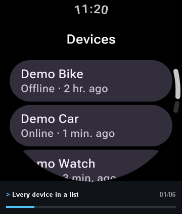
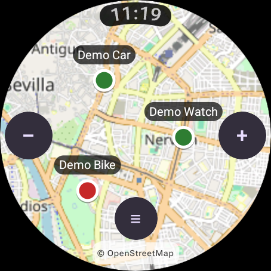
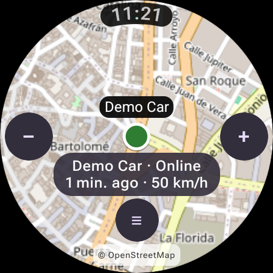
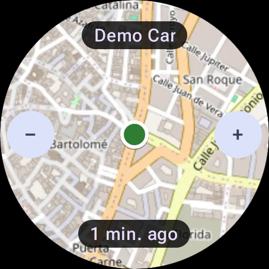
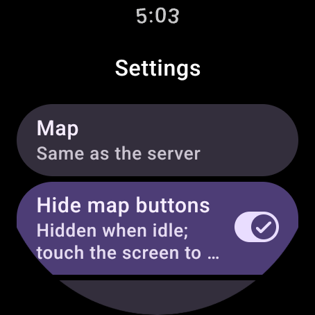
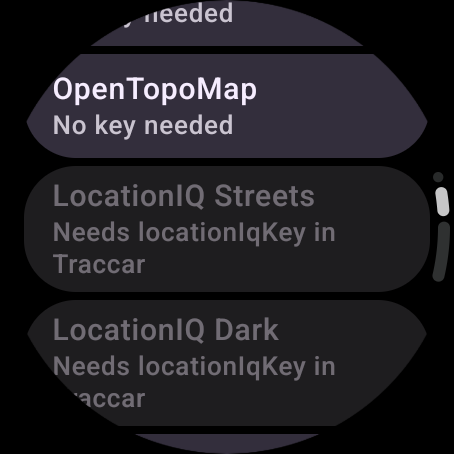
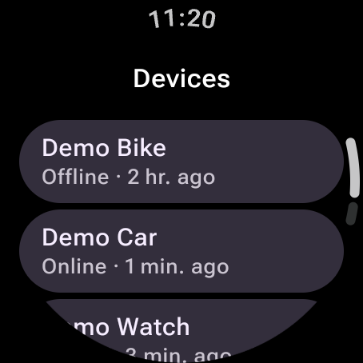

<!--
  TODO before going public:
  - Check the repository name in the badges and links (Eduzyrtin/TraccarWearViewer).
  - Publish a first release so the "download" badge and the APK link work.
  - Check the Play Store link (the application id is com.sanabria.traccarwearosviewer) once the app is published.
-->

<div align="center">

# Wear OS Viewer for Traccar

### Your Traccar devices on a map, right on your wrist.

A small Wear OS app for your own [Traccar](https://www.traccar.org) server: see where your devices are,
follow one of them live, pin a map tile per person or vehicle, and get alerts when you are away from your phone.<br>
No Firebase and nothing to configure on the server.

[](#requirements)
[](https://www.traccar.org)
[](LICENSE)
[](#features)
[](https://github.com/Eduzyrtin/TraccarWearViewer/releases/latest)



<table>
  <tr>
    <td align="center"><br><sub>Every device on one map</sub></td>
    <td align="center"><br><sub>Select one and the map follows it</sub></td>
    <td align="center"><br><sub>A tile per person or vehicle</sub></td>
  </tr>
</table>

**[Download the APK](https://github.com/Eduzyrtin/TraccarWearViewer/releases/latest)** · [Getting started](#getting-started) · [Map types and API keys](#map-types-and-api-keys) · [FAQ](#faq)

> **Free here, paid on Google Play.** The APK on GitHub is completely free. If you would rather install it from the Play Store, that edition is the **paid version, as a way of donating** to the project: **[Viewer for Traccar on Google Play](https://play.google.com/store/apps/details?id=com.sanabria.traccarwearosviewer)**. Same app either way.

</div>

---

## Why this exists

The official Traccar apps are made for the phone, and they are Flutter apps that do not run on Wear OS. This one
is a **viewer, not a manager**: it does one job well on a small round screen. To administer your server, keep
using the web interface or the official Traccar Manager on your phone.

It works with any **Traccar 6** server without changing its configuration, talking to the REST API with a token.
Your password is only used once to get that token and is **never stored on the watch**.

This is an independent project and is not affiliated with or endorsed by Traccar.

## Features

### 🗺️ A map, like the web app
- The main screen is a map with **every tracked device**, colored by status (green online, red offline, grey unknown) and fitted on open.
- **Zoom** with the crown or bezel, the +/− buttons, double tap or pinch. **Drag** to move.
- Tap a device to **select** it: a card shows its status, last update and speed. Tap the card for more details.
- Positions refresh every 30 seconds while the map is visible.

### 🎯 Follow a device
- While a device is selected, the map **keeps it centered** as it moves, until you close the app or deselect it.
- Dragging the map stops following; tap the device again to resume.
- The **+/− and ≡ buttons hide** after 4 seconds without touching the screen and come back with a touch, so the map stays clean. You can keep them always visible in *Settings*.

### 🧩 A tile per person or vehicle
- Add the tile once for each device you want to keep an eye on, for example **your partner's car**: it shows the area around it with no coordinates, and **+/−** zoom buttons.
- Tap the **name** to pick another device, tap the **time** to refresh, tap the **map** to open the app centered on it.
- The tile asks for an update **every time it comes into view**, so it shows the latest position.

### 🔔 Alerts, only if you want them
- Off by default. Choose *only when the phone is not nearby* (with the phone connected over Bluetooth the official Traccar Manager already notifies you) or *always*.
- The watch checks the event types you configured under *Notifications* in Traccar, every 15 minutes. **No Firebase, no server setup.**

### ⌨️ Made for typing on a watch
- Nothing is masked, long values wrap onto several lines and every text field has a **Clear** button.
- Available in **English, Spanish, French, German, Italian, Portuguese, Catalan, Basque and Galician**.

## Getting started

### Requirements
- A watch with **Wear OS 3 or newer** (API 30+), with Wi-Fi or LTE if you want it away from the phone.
- A **Traccar 6** server you can reach from the watch.

### 1 · Install the APK
Download the latest `.apk` from **[Releases](https://github.com/Eduzyrtin/TraccarWearViewer/releases/latest)** and install it on the watch, for example with `adb install` over Wi-Fi debugging. Only install it from this repository's Releases page.

### 2 · Sign in
Open the app, enter your **server URL**, **email** and **password**, and tap *Sign in*. You get a token valid for a year; the password is not kept.

### 3 · Use it
The map opens with all your devices. For a tile, add **Traccar map** from your watch's tile carousel (the exact steps depend on the watch), then tap the device name on the tile to choose which device it shows.

## Map types and API keys

Choose the map in *Settings › Map*. The default, *Same as the server*, uses the map configured on your Traccar server when it is one of the maps below (or a raster custom XYZ URL), and OpenStreetMap otherwise.

| Map in the app | Traccar map id | API key attribute | Where to get a key |
|---|---|---|---|
| OpenStreetMap | `osm` | none | — |
| OpenTopoMap | `openTopoMap` | none | — |
| LocationIQ Streets | `locationIqStreets` | `locationIqKey` | [locationiq.com](https://locationiq.com) (free plan, "Access Token", starts with `pk.`) |
| LocationIQ Dark | `locationIqDark` | `locationIqKey` | same key |
| MapTiler Basic | `mapTilerBasic` | `mapTilerKey` | [maptiler.com](https://www.maptiler.com/cloud/) (free plan, "API key") |
| MapTiler Hybrid | `mapTilerHybrid` | `mapTilerKey` | same key |
| TomTom Basic | `tomTomBasic` | `tomTomKey` | [developer.tomtom.com](https://developer.tomtom.com) (free plan, "API key") |
| HERE Basic | `hereBasic` | `hereKey` | [platform.here.com](https://platform.here.com) (free plan, "API key") |
| HERE Hybrid | `hereHybrid` | `hereKey` | same key |
| HERE Satellite | `hereSatellite` | `hereKey` | same key |
| Mapbox Streets | `mapboxStreets` | `mapboxAccessToken` | [mapbox.com](https://www.mapbox.com) (free plan, "Default public token", starts with `pk.`) |
| Mapbox Dark | `mapboxStreetsDark` | `mapboxAccessToken` | same token |
| Mapbox Outdoors | `mapboxOutdoors` | `mapboxAccessToken` | same token |
| Mapbox Satellite | `mapboxSatellite` | `mapboxAccessToken` | same token |

The map ids and attribute names are the same ones the Traccar web app uses, so if you already configured a key for the web app, the watch picks it up with no extra work.

### How to add an API key

Keys are never typed on the watch: they are stored in Traccar and the app reads them from there.

1. Get a key from the provider (see the table above). The free plans are enough for personal use.
2. In the Traccar **web app**, add it as an attribute with the exact name from the table (case sensitive), type *String*:
   - **Only for you:** *Settings › Account*, section *Attributes*, **+**, then save.
   - **For every user of the server** (administrators only): *Settings › Server*, section *Attributes*, **+**, then save.

   If a key is set in both places, your own account's key wins.
3. On the watch, open the map or tap *Refresh* in the device list so the app reads the new key.
4. Go to *Settings › Map*. Maps whose key is present are now enabled; the rest are shown disabled with the name of the missing attribute.

Example: for LocationIQ, add an attribute named `locationIqKey` with your `pk....` token, then pick *LocationIQ Streets* on the watch.

<table>
  <tr>
    <td align="center"><br><sub>Settings</sub></td>
    <td align="center"><br><sub>Maps that need a key show which one</sub></td>
    <td align="center"><br><sub>The device list</sub></td>
  </tr>
</table>

Not included, on purpose: vector-only maps (OpenFreeMap), regional ones (Yandex, AutoNavi, Tencent, Ordnance Survey), Bing (retired), Google (its tiles need the paid Map Tiles API) and CARTO (now requires a key). If the chosen map is not available, the app falls back to OpenStreetMap.

### Map attribution

The small text at the bottom of the map (for example "© LocationIQ © OpenStreetMap") is **required by the licenses** of the map data (OpenStreetMap's ODbL) and by each provider's terms of use, so the app always shows it and it cannot be turned off. If you fork the app, keep it.

## Privacy

- The app talks **only to the Traccar server you enter** and to the map provider you choose (to download map tiles). No analytics, no ads, no accounts.
- It stores a token (not your password) in its private storage, which is excluded from backups.
- Alerts are fetched from your own server; nothing goes through third parties.

## FAQ

<details>
<summary><b>Do I need an app on my phone?</b></summary>

No. The watch app is standalone. If the phone also has the official Traccar Manager, it keeps notifying you there; this app can complete it with its own alerts when the phone is away.
</details>

<details>
<summary><b>Does it work with an LTE watch away from the phone?</b></summary>

Yes, that is the point of the alerts mode *only when the phone is not nearby*. The watch only needs internet access (LTE or Wi-Fi) to reach your server.
</details>

<details>
<summary><b>Why do alerts take up to 15 minutes?</b></summary>

That is the shortest interval Android's WorkManager allows for periodic background work, and a persistent connection would cost a lot of battery. A real-time option over WebSocket is on the roadmap.
</details>

<details>
<summary><b>The map follows a device, but stops when the screen turns off.</b></summary>

Wear OS turns the screen off after a few seconds to save battery. The map catches up with the latest position as soon as you wake it. Use the tile for a quick look.
</details>

<details>
<summary><b>Can I sign in with SSO / OpenID?</b></summary>

Not yet: sign-in is with email and password. Support for pasting a token is planned.
</details>

<details>
<summary><b>Can I use an http:// server?</b></summary>

Yes, plain HTTP is allowed because many self-hosted servers use it. Use HTTPS whenever you can, since the token travels in every request.
</details>

<details>
<summary><b>Why is there a watermark on the map?</b></summary>

It is the map data attribution, required by the licenses. See [Map attribution](#map-attribution).
</details>

<details>
<summary><b>Can I switch between the GitHub APK and the Play Store version?</b></summary>

They are signed with different keys, so one cannot update the other. Uninstall first; you will have to sign in again.
</details>

## Found a bug? Have an idea?

Please open an **[issue](https://github.com/Eduzyrtin/TraccarWearViewer/issues)** with your watch model, Wear OS version and what you were doing.

## Support the project

Viewer for Traccar is a passion project and the APK here is **free**. If it is useful to you:

- ☕ **[Buy me a coffee on Ko-fi](https://ko-fi.com/Eduzyrtin)**
- ▶️ Get the **[Play Store edition](https://play.google.com/store/apps/details?id=com.sanabria.traccarwearosviewer)**: the same app, offered there as a **paid version in donation format**, with automatic updates.
- ⭐ Star the repo and tell someone who tracks their cars or bikes with Traccar.

Looking for the other half? **[Tracker for Traccar](https://github.com/Eduzyrtin/TraccarWearClient)** sends your watch's own location to your server.

## Building from source

Requirements: Android Studio (or JDK 17+), Android Gradle Plugin 9.4 and Android SDK 37.

```bash
git clone https://github.com/Eduzyrtin/TraccarWearViewer.git
cd TraccarWearViewer
./gradlew assembleDebug
```

The APK is generated in `app/build/outputs/apk/debug/`. To see the tile on an emulator, add it from the tile carousel.

### Test defaults (debug builds only)

To save typing on a watch while developing, create a `test-defaults.properties` file in the project root (it is git-ignored) and the debug build will prefill the sign-in form:

```properties
server=https://your-server:8082
email=you@example.com
password=your-password
```

Release builds ignore this file. Do not share a debug APK built with it: the values are inside.

### Project structure

| Path | Purpose |
|---|---|
| `api/TraccarApi.kt` | REST client (OkHttp + kotlinx.serialization) |
| `map/` | Raster map: map types, projection, tile download and cache, image rendering for the tile |
| `data/` | DataStore storage and repository |
| `tile/` | Map tile (one device per tile) and its image cache |
| `notify/` | Periodic event check and notifications |
| `ui/` | Wear OS screens |

## Status and roadmap

Tested on the Wear OS API 34 emulator against a local mock server (sign-in, map, follow, tile, device picker, map types) and signed in against a real Traccar 6 server. Not yet tested on a physical watch.

- Test on real hardware.
- Optional real-time alerts over WebSocket.
- Sign-in with a pasted token (for SSO accounts).

## Credits

- **[Traccar](https://www.traccar.org)**, the open source GPS tracking platform this app is a client for.
- **[OpenStreetMap](https://www.openstreetmap.org/copyright)** contributors, and the map providers listed above, for the maps.
- Built with Jetpack Compose for Wear OS, Wear Tiles / ProtoLayout, OkHttp, kotlinx.serialization and WorkManager.

## License

Copyright (C) 2026 Eduardo Sanabria.

Viewer for Traccar is free software released under the **[GNU General Public License v3.0](LICENSE)**. You can use, study, share and modify it, and any modified version you distribute has to stay under the same license.

<div align="center">
<sub>"Traccar" is a trademark of its respective owners. This app is not affiliated with them.</sub>
</div>
